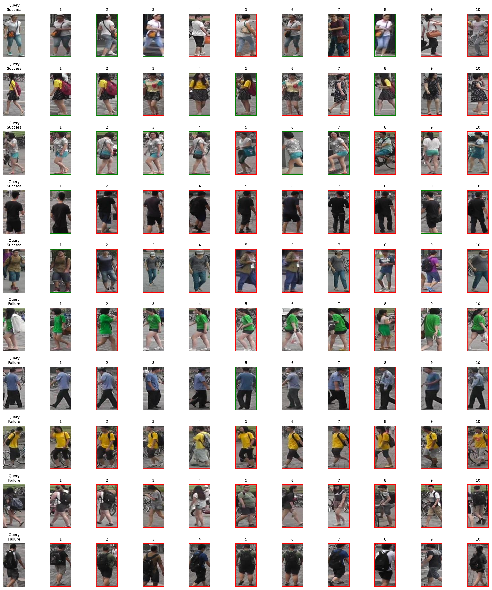

# Laboratorio 3: resultados de reidentificacion no supervisada

## Configuracion registrada

Protocolo paper_adapted_v3; hasta 8 rondas de 8 epocas por metodo, batch 64. Las rondas se numeran desde cero. El limite de tiempo puede reducir las rondas completas; se comparan solo las rondas terminadas y validadas por los tres metodos. La configuracion exacta y huellas del codigo estan en experiment_config.json.

## Metodologia y adaptacion

ResNet-50 preentrenada en ImageNet extrae vectores globales, superiores e inferiores. Las pseudoetiquetas se generan sin identidades reales; si DBSCAN crea un grupo dominante, se usa K-means esferico y se reservan asignaciones inciertas como outliers. MLCOR recupera hasta 40 outliers por ronda mediante vecinos reciprocos y confianza. CEM combina una memoria de instancias para GEL con restricciones globales/locales C-DTL.

Adaptaciones respecto al paper: fusion de distancias coseno en vez de Jaccard, respaldo K-means ante colapso de DBSCAN y presupuesto de entrenamiento propio. El conjunto de prueba no participa en entrenamiento ni seleccion.

## Comparacion y ablacion en validacion

| Metodo | Ronda | mAP original | Rank-1 | Rank-5 | Rank-10 | mAP baja resolucion | Rank-1 baja | Rank-5 baja | Rank-10 baja | Caida mAP |
|---|---:|---:|---:|---:|---:|---:|---:|---:|---:|---:|
| baseline | round_07 | 0.2071 | 0.3600 | 0.4700 | 0.5400 | 0.0906 | 0.1200 | 0.2500 | 0.3500 | 0.1165 |
| cem_only | round_04 | 0.2893 | 0.4400 | 0.6700 | 0.7200 | 0.1178 | 0.2200 | 0.3200 | 0.4600 | 0.1715 |
| full | round_03 | 0.2606 | 0.4100 | 0.5500 | 0.6000 | 0.1125 | 0.1900 | 0.3700 | 0.4500 | 0.1481 |

Efecto de CEM frente a baseline: +0.0823 mAP. Efecto adicional de MLCOR frente a CEM: -0.0288 mAP. Son diferencias descriptivas de una semilla y de 100 consultas de validacion; no prueban significancia estadistica ni identifican la causa de una caida. Son resultados de esta adaptacion, no cifras publicadas del paper.

Se selecciono **cem_only** por mayor mAP original en validacion.

## Evaluacion final en testing

| Condicion | mAP | Rank-1 | Rank-5 | Rank-10 |
|---|---:|---:|---:|---:|
| original | 0.1078 | 0.2539 | 0.3777 | 0.4469 |
| low_resolution | 0.0258 | 0.0683 | 0.1532 | 0.1992 |

Caida de mAP: **0.0820**.

## Cinco aciertos y cinco fallos

### Aciertos

- Consulta 3, camara 2: la primera imagen recuperada tiene la misma identidad (1383) desde la camara 1.
- Consulta 6, camara 3: la primera imagen recuperada tiene la misma identidad (811) desde la camara 5.
- Consulta 9, camara 5: la primera imagen recuperada tiene la misma identidad (1319) desde la camara 3.
- Consulta 16, camara 4: la primera imagen recuperada tiene la misma identidad (319) desde la camara 1.
- Consulta 17, camara 2: la primera imagen recuperada tiene la misma identidad (238) desde la camara 3.

### Fallos

- Consulta 0, camara 3: el primer resultado es otra identidad (284); la identidad correcta aparece por primera vez en el rango 23.
- Consulta 1, camara 5: el primer resultado es otra identidad (728); la identidad correcta aparece por primera vez en el rango 3.
- Consulta 2, camara 4: el primer resultado es otra identidad (812); la identidad correcta aparece por primera vez en el rango 670.
- Consulta 4, camara 5: el primer resultado es otra identidad (1272); la identidad correcta aparece por primera vez en el rango 88.
- Consulta 5, camara 1: el primer resultado es otra identidad (226); la identidad correcta aparece por primera vez en el rango 31.

## Limitaciones

Las pseudoetiquetas pueden mezclar identidades visualmente parecidas. La particion K-means es un respaldo cuando DBSCAN se vuelve degenerado, y puede crear grupos artificiales. La baja resolucion elimina detalles utiles para distinguir ropa y siluetas; la magnitud observada del efecto se muestra arriba. La figura debe inspeccionarse visualmente para describir causas como ropa, oclusion o postura en la presentacion oral; esas causas no se infieren de los IDs.

## Análisis visual detallado

Consulte [cinco aciertos y fallos explicados](resultados/ANALISIS_ERRORES.md).

## Diferencias respecto al artículo y ejecución

Consulte [README de la entrega](README_ENTREGA.md). La mejora de CEM y el efecto adicional de MLCOR se comparan en validación; test corresponde únicamente al ganador.

## Advertencias de interpretación

Los resultados son modestos: Rank-1 HR 25.39% y LR 6.83%. No permiten identificación autónoma fiable. Una sola semilla y cien consultas de validación limitan las conclusiones. La galería test es mucho mayor que la de validación, por lo que la brecha no permite diagnosticar por sí sola sobreajuste. V2 fue un experimento previo: el test V3 es final dentro de V3, no una garantía de ausencia de exposición a test a lo largo de todo el proyecto.
